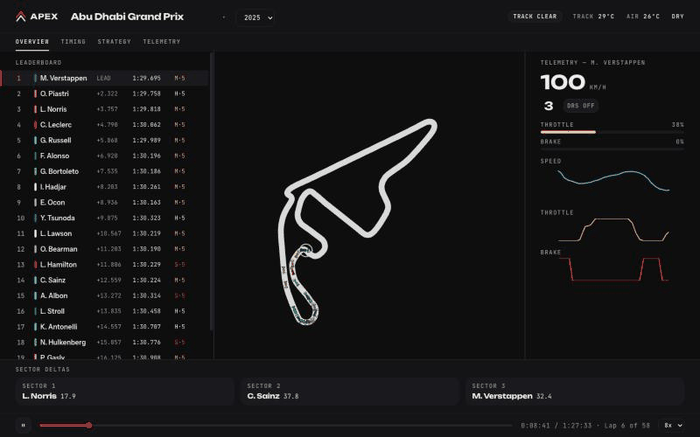
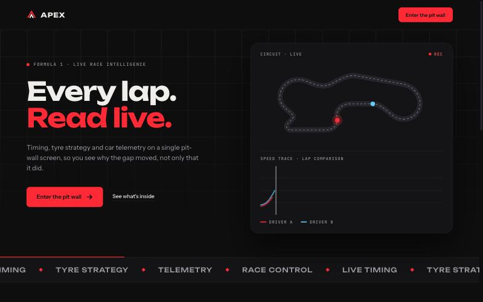
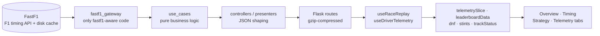
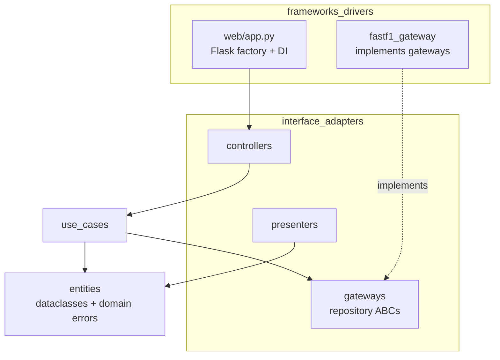
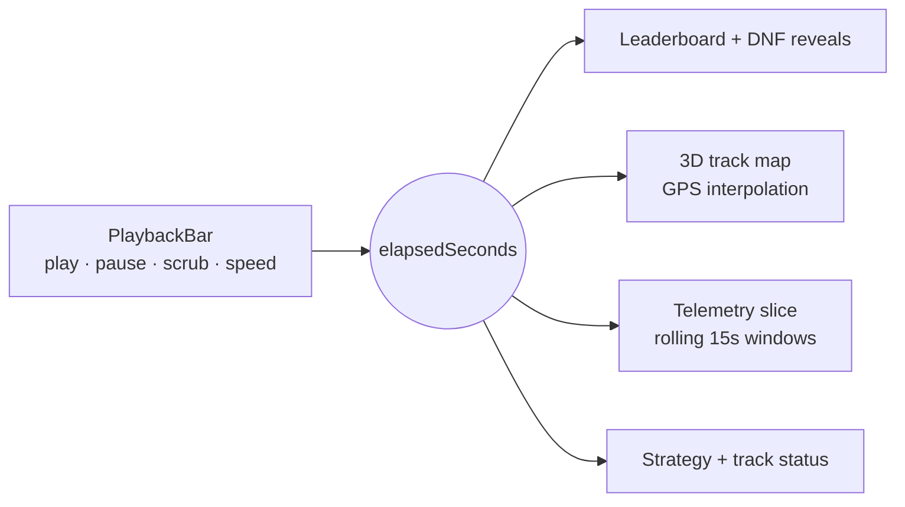

<h1 align="center">APEX — F1 Interactive Race Dashboard</h1>
<p align="center"><b>Replay any Formula 1 race since 2018 second-by-second — real GPS car positions on a 3D track, live telemetry, and tire strategy — for fans who want to see how a race actually unfolded.</b></p>

<p align="center">
  
</p>

<p align="center">
  <a href="https://apex.waynechiu.com">Live Demo</a>
</p>

<p align="center">
  
  
  
  
  
  
  
  
  
  
</p>

---

## Why I Built This

Most "F1 dashboard" projects stop at a table of lap times, which can't answer "where is every car *right now*?" I wanted a replay that behaves like a live timing wall: a 90-minute race plays back in 90 minutes (or up to 8x faster), with every view — positions, gaps, tire stints, telemetry — staying in sync with one scrubbable clock. It's a personal project, and an excuse to build a full design system (**APEX**) tokens-first, the way a product team would.

## Highlights

- **1 clock, every view**: leaderboard, 3D map, telemetry, DNFs, and track status are all pure functions of a single `elapsedSeconds` value, so scrubbing backward correctly un-reveals retirements and recomputes standings.
- **Real GPS, not schematics**: car positions come from FastF1's ~2Hz position samples, interpolated to a smooth 30Hz render loop.
- **Tested domain layer**: 71 backend unit and integration tests run against hand-written fakes with no network or FastF1 calls.
- **Every season since 2018** selectable from one picker, with 3D elevation derived from real altitude data.

## Demo & Screenshots

| Race Center replay | Landing page |
|---|---|
|  |  |

*2025 Abu Dhabi Grand Prix at 8x replay speed.*

## Features

- **Real-time race replay**: play, pause, scrub, and change speed (1x–8x).
- **3D track map**: rotate/zoom/pan a circuit with real elevation and a team-colored F1 car at each driver's live position; click a car to select that driver.
- **Live telemetry**: speed, throttle, brake, gear, RPM, and DRS for the selected driver, with charts that follow the live edge and pause when you scroll back.
- **Dynamic leaderboard**: position, gaps, tire compound and age, with animated reordering and correct DNF handling (including lap-1 retirements).
- **Strategy tab**: pit stop log and tire stint history per driver.
- **Track status**: safety car, VSC, yellow and red flag periods.
- **Resizable layout**: drag-to-resize panels across every tab.
- **Landing page and loading sequence**: a progress bar that tracks real in-flight requests, not a fake spinner.

## Architecture



#### Backend layers (dependencies point inward)



#### Frontend: one clock drives every view



The backend follows Clean Architecture: `entities/` and `use_cases/` never import Flask or FastF1, and only `fastf1_gateway/` talks to the data source, so swapping FastF1 would touch one directory. The frontend is a single React page whose tabs all read from one playback clock. The UI runs on the APEX design system in `design_system/` (tokens, motion spec, component docs); nothing hard-codes a color, radius, or font.

### Key design decisions

| Decision | Alternatives considered | Why I chose this |
|---|---|---|
| Real ~2Hz GPS samples with binary-search interpolation | Lap-by-lap progression with approximated positions (my first version) | Lap-level progress couldn't answer where a car is right now |
| One `elapsedSeconds` clock, pure derivations | Per-tab playback state | Scrubbing, speed changes, and race switching are consistent by construction, not by careful synchronization |
| Zero FastF1 `Z` against the track's own minimum | Using raw `Z` directly | `Z` is absolute altitude (meters above sea level) and would place geometry far outside camera bounds |
| Clean Architecture backend | Calling FastF1 straight from Flask routes | Business logic is testable with fakes, fast and deterministic |
| Separate yaw and pitch quaternions, composed `yaw * pitch` | A single Euler rotation | Cars pitch along their own heading rather than toward world-space up/down |
| Weighted loading progress model | Spinner for an arbitrary duration | The full session fetch dominates load time, so progress reflects what is actually happening |

## Tech Stack

| Layer | Technology | Why |
|---|---|---|
| Frontend | React 19, Vite 7 | Fast dev loop, single-page app with no router needed |
| 3D | Three.js, @react-three/fiber, @react-three/drei | Declarative 3D track, car models, and orbit camera |
| Backend | Flask 3, flask-compress, flask-cors | Small, thin HTTP layer over the use cases |
| Data | FastF1 3.7, pandas | Official timing, telemetry, and GPS data with a built-in disk cache |
| Tooling | ESLint, pytest | Linting and fast fake-based tests |

## Challenges & What I Learned

**Challenge 1: Making dozens of views agree on "now"**
- *Problem:* Leaderboard order, DNF visibility, tire stints, telemetry windows, and the 3D map each need the race state at the same instant, and users can scrub in either direction.
- *Approach:* Replaced per-view state with a single `elapsedSeconds` clock and pure derivation functions (`raceClock.js`, `dnf.js`, `stints.js`, `telemetrySlice.js`).
- *Result:* Scrubbing is correct by construction. The clock commits updates at a throttled 30Hz so rendering stays smooth.

**Challenge 2: Raw GPS data that isn't 3D-ready**
- *Problem:* FastF1's `Z` is absolute altitude, which put the track far outside sane bounds in the 3D scene.
- *Approach:* Normalize x/y onto the ground plane and zero elevation against the track's own minimum (`trackGeometry3d.js`).
- *Result:* A correctly scaled circuit with real elevation, and cars that pitch with the slope beneath them.

**Takeaways:** Deriving everything from one source of truth removed whole classes of sync bugs. I'd add CI and browser-level tests earlier, and I now understand interpolation, quaternion composition, and clean layering much more deeply.

## Getting Started

### Prerequisites
- Python 3.11
- Node.js 20+

### Run locally

```bash
git clone https://github.com/Wayne-cyw/F1-Interactive-Race-Dashboard.git
cd F1-Interactive-Race-Dashboard

# Backend
python3 -m venv .venv
source .venv/bin/activate
pip install -r backend/requirements.txt
python3 backend/run.py              # → http://localhost:5000

# Frontend (separate terminal)
npm install
npm run dev                         # → http://localhost:3000 (proxies /api to Flask)
```

Open http://localhost:3000, click **Enter the pit wall**, pick a season and race, and hit play. No API keys or `.env` file are required.

> **First load of any session takes 30–60 seconds** while FastF1 fetches from the F1 timing API. Later loads read from `backend/cache/` and are near-instant.

### Run tests

```bash
cd backend && python -m pytest -q    # 71 unit + integration tests, no live FastF1 calls
npm run lint
npm run build                        # production build → dist/
```

## API

All responses are JSON and gzip-compressed. Base URL: `http://localhost:5000/api`.

| Endpoint | Returns |
|---|---|
| `GET /api/seasons` | Available seasons (2018–present) |
| `GET /api/races/<year>` | Race schedule for a season |
| `GET /api/session/<year>/<round>/<type>` | Laps, results, pit stops |
| `GET /api/session-types/<year>/<round>` | Which sessions exist (R / Q / S / FP1-3) |
| `GET /api/telemetry/<year>/<round>/<type>/<driver>` | Speed/throttle/brake/gear/RPM/DRS, relative to green flag |
| `GET /api/positions/<year>/<round>` | Per-driver `{t, x, y, z}` GPS timeline at 2Hz |
| `GET /api/track-status/<year>/<round>` | Green/yellow/VSC/safety car/red flag timeline |
| `GET /api/track/<year>/<round>` | Track outline as `{x, y, z}` coordinates |
| `GET /api/standings/<year>` | Driver and constructor standings |
| `GET /api/teams/<year>` | Team rosters with driver codes |
| `GET /api/weather/<year>/<round>` | Air/track temperature, humidity, rainfall |
| `GET /api/pitstops/<year>/<round>` | Pit stop history |

## Project Structure

```
F1-Interactive-Race-Dashboard/
├── backend/
│   ├── entities/               # plain dataclasses + domain errors
│   ├── use_cases/              # one class per operation
│   ├── interface_adapters/     # gateways (ABCs), controllers, presenters
│   ├── frameworks_drivers/     # Flask app factory, FastF1 gateway
│   └── tests/                  # unit (fakes) + integration (Flask client)
├── frontend/
│   ├── pages/landing/          # landing page
│   └── pages/live-race/        # Race Center: tabs, hooks, derivations, 3D map
├── design_system/              # APEX tokens, motion spec, component docs
└── docs/                       # design specs and plans
```

## Testing & Quality

- **71 backend tests**: use cases against hand-written fakes, plus integration tests with the real Flask app factory and fake repositories injected.
- **ESLint** for the frontend; production build verified with `npm run build`.
- No CI pipeline or frontend test suite yet (see Roadmap).

## Roadmap

- [x] Real-time replay with GPS-driven 3D track map
- [x] Telemetry, leaderboard, strategy, and track status views
- [x] APEX design system, landing page, and loading sequence
- [ ] Wire the standings and teams endpoints to a view (currently backend-only)
- [ ] Qualifying and sprint session replay (endpoints already support any session type)
- [ ] Driver-to-driver telemetry comparison overlay
- [ ] CI pipeline and frontend tests

## About Me

I'm Wayne Chiu, a software engineer building full-stack data products.

[GitHub](https://github.com/Wayne-cyw) · [Email](mailto:wayne.chiu0823@gmail.com)

## License

[MIT](LICENSE). Unofficial fan project — not affiliated with Formula 1 or any team.
